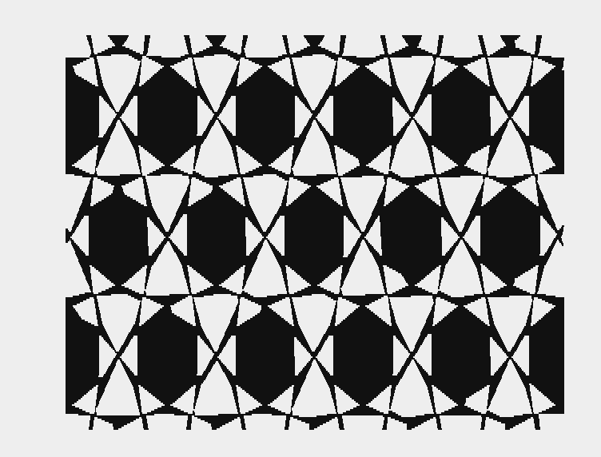

<strong>Polski</strong> | <a href="CHANGELOG_EN.md">English</a> | <a href="README.md">README</a>

# Historia Zmian — A1200 Vector Engine

## v1.1.2 — Intrinsic Gravity (Still), `--crisp-opart` & `--anti-flicker` (2026-11-27)

|  |
|:---:|
| **Intrinsic Gravity (Still — `pixtur` & `Hoffman`) — 50 FPS PAL (`--crisp-opart`)** |

- **Nowe demo pokazowe: *Intrinsic Gravity* (Still — `pixtur` & `Hoffman`, 2014):** pełna adaptacja op-art wektorowego w 50 FPS PAL dla wszystkich 3 obozów (`020 + Blitter AA`, `THEA1200 HiRes 640×256`, `060 Interlace 640×512`).
- **Tryb `--crisp-opart` i filtr `--anti-flicker` (`tools/build_demo.py`, `tools/profile_patch.py`):** zwiększono limit wierzchołków na klatkę do `2400` (`THEA1200`) / `3200` (`060`), wyłączono rozmywanie krawędzi dla czystej geometrii oraz odfiltrowano 1- i 2-klatkowe błyski stroboskopowe.
- *Uwaga: Dema **Median A1200** (`v1.1.1`) oraz **Bad Apple!! A1200** (`v1.1.0`) pozostają na swoich oryginalnych wydaniach silnika.*

---

## v1.1.1 — Eon (TBL) Cutscenes & Native MC68060 (2026-11-25)

- **Moduł scen rotoskopowych *Eon* (TBL) (`src/eon_poly_player.i`):** bezkonturowy odtwarzacz wielotonowych wielokątów N-gon w 256 kolorach AGA (`af_play_eon_scene`) przeniesiony z gry *Aether Falcon: Vanguard*.
- **Natywna obsługa MC68060 (`src/whdload_slave.s`, `tools/build_demo.py`, `tools/build_median.py`):** flaga WHDLoad `$0026`, **7.5 MB Fast RAM** (`$00780000`), 32-bitowy rejestr **`CACR = $A0808000`** oraz flaga kompilacji `-DM68060` dla profili `060`.
- **Wydanie *Median A1200 v1.1.1*:** 3 profile sprzętowe (`020 + Blitter AA`, `THEA1200 HiRes 640×256`, `060 Interlace 640×512`).

---

## v1.1.0 — Three Target Profiles & AGA Blitter AA 320×256 (2026-11-24)

- **Trzy obozy wydawnicze (`--profile`):** `standard` (`320×256 AGA + Blitter AA` dla bazowej A1200 i RetroArch Android), `thea1200` (`640×256 AGA Hi-Res + Fast-RAM movem.l`), `060` (`640×512 AGA Interlace 1:1` + `14.6–16.5 kHz` PCM).
- **Natywny tryb AGA + Blitter AA `320×256` (`BPLCON0 = $A200`, `DDFSTRT = $0028`, `DDFSTOP = $00B8`, `FMODE = $0003`):** 2× wyższa ostrość pozioma wektorów przy `50.00 FPS PAL` oraz szybki transfer `movem.l` (`48 B/iter`) z Fast RAM do Chip RAM.
- **Kompatybilność WHDLoad / Amiberry / THEA1200:** zapasowy `S/startup-sequence` w `.lha`, flaga `$0026`, pełna synchronizacja pól `LOF` oraz wyjście przyciskiem Fire na Joystick Port 2 (`$BFE001` bit 7) obok LPM i `ESC`.
- **Wydanie *Bad Apple!! A1200 v1.1.0*:** przeliczone wektory `320×256` / `640×256` / `640×512` dla wszystkich 3 obozów.

---

## v1.0.1 (2026-11-23)

- Dodanie archiwów `*_FSUAE.zip` z auto-bootem `S/startup-sequence` oraz matrycy kompatybilności.

---

## v1.0.0 (2026-11-22)

- Pierwsze wydanie silnika wektorowego M68020+ / AGA (`320×256 @ 50 FPS`) z WHDLoad Slave v17.
