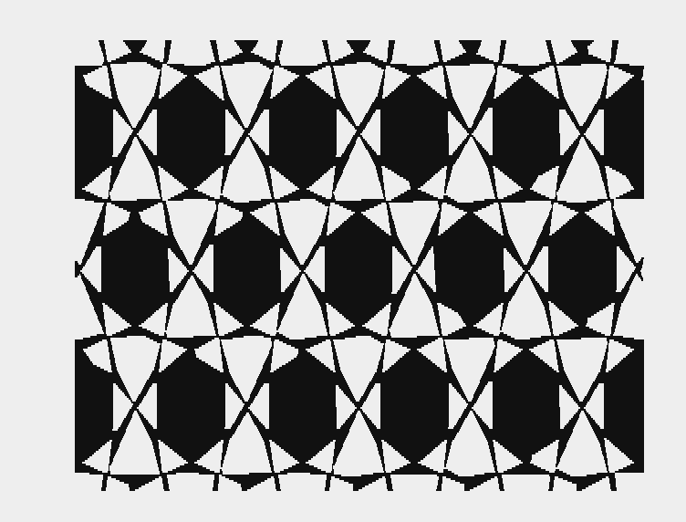

<a href="CHANGELOG.md">Polski</a> | <strong>English</strong> | <a href="README_EN.md">README</a>

# Changelog — A1200 Vector Engine

## v1.1.2 — Intrinsic Gravity (Still), `--crisp-opart` & `--anti-flicker` (2026-11-27)

|  |
|:---:|
| **Intrinsic Gravity (Still — `pixtur` & `Hoffman`) — 50 FPS PAL (`--crisp-opart`)** |

- **New Showcase Demo: *Intrinsic Gravity* (Still — `pixtur` & `Hoffman`, 2014):** full 50 FPS PAL op-art vector port across all 3 hardware profiles (`020 + Blitter AA`, `THEA1200 HiRes 640×256`, `060 Interlace 640×512`).
- **`--crisp-opart` Mode & `--anti-flicker` Filter (`tools/build_demo.py`, `tools/profile_patch.py`):** raised vertex budget to `2,400` (`THEA1200`) / `3,200` (`060`), disabled median blur for razor-sharp geometry, and filtered 1- and 2-frame strobe flashes.
- *Note: **Median A1200** (`v1.1.1`) and **Bad Apple!! A1200** (`v1.1.0`) remain on their original engine releases.*

---

## v1.1.1 — Eon (TBL) Cutscenes & Native MC68060 (2026-11-25)

- ***Eon* (TBL) Rotoscoped Scene Module (`src/eon_poly_player.i`):** contour-free multi-tone 256-color AGA N-gon polygon player (`af_play_eon_scene`) ported from *Aether Falcon: Vanguard*.
- **Native MC68060 Support (`src/whdload_slave.s`, `tools/build_demo.py`, `tools/build_median.py`):** `$0026` WHDLoad flags, **7.5 MB Fast RAM** (`$00780000`), 32-bit **`CACR = $A0808000`**, and `-DM68060` compilation flag for `060` profiles.
- ***Median A1200 v1.1.1* Release:** 3 hardware profiles (`020 + Blitter AA`, `THEA1200 HiRes 640×256`, `060 Interlace 640×512`).

---

## v1.1.0 — Three Target Profiles & AGA Blitter AA 320×256 (2026-11-24)

- **Three Target Profiles (`--profile`):** `standard` (`320×256 AGA + Blitter AA` for stock A1200 and RetroArch Android), `thea1200` (`640×256 AGA Hi-Res + Fast-RAM movem.l`), `060` (`640×512 AGA Interlace 1:1` + `14.6–16.5 kHz` PCM).
- **Native AGA + Blitter AA `320×256` (`BPLCON0 = $A200`, `DDFSTRT = $0028`, `DDFSTOP = $00B8`, `FMODE = $0003`):** 2× horizontal vector sharpness at `50.00 FPS PAL` with unrolled `movem.l` (`48 B/iter`) Fast-to-Chip RAM bursts.
- **WHDLoad / Amiberry / THEA1200 Compatibility:** fallback `S/startup-sequence` in `.lha`, `$0026` flags, full `LOF` field sync, and exit via Fire on Joystick Port 2 (`$BFE001` bit 7) alongside LMB and `ESC`.
- ***Bad Apple!! A1200 v1.1.0* Release:** pre-compiled `320×256` / `640×256` / `640×512` vector streams across all 3 profiles.

---

## v1.0.1 (2026-11-23)

- Added auto-booting `*_FSUAE.zip` archives with `S/startup-sequence` and hardware compatibility matrix.

---

## v1.0.0 (2026-11-22)

- Initial release of the bare-metal M68020+ / AGA vector engine (`320×256 @ 50 FPS`) with WHDLoad Slave v17.
