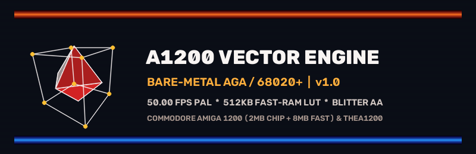
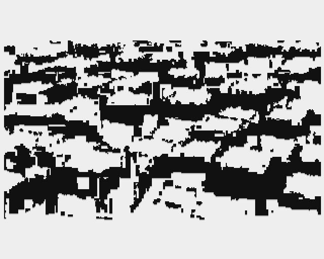

<strong>Polski</strong> | <a href="README_EN.md">English</a> | <a href="CHANGELOG.md">Historia Zmian (PL)</a> | <a href="CHANGELOG_EN.md">Changelog (EN)</a>

  
  <h1>Amiga 1200 / THEA1200 Vector Stream Demo Engine v1.1.0</h1>
  
<strong>Bare-metal M68020+ / AGA Hi-Res 640x256 @ 50.00 FPS PAL Vector Demo Engine</strong>

  
<em>Credits: malek69 &amp; Gemini AI (Vibe Coding Edition, 2026)</em>

---

## Pobieranie i Podglad (v1.1.0 Latest)

| Median A1200 v1.1.0 (Hi-Res 640x256) | Bad Apple!! A1200 v1.1.0 (Hi-Res 640x256) |
| :---: | :---: |
|  |  |
| **[Pobierz .LHA — THEA1200 / RetroArch](https://github.com/malek69/amiga1200-vector-engine/releases/download/v1.1.0/MedianA1200_AGA_THEA1200.lha)** **[Pobierz .ZIP — FS-UAE / WinUAE](https://github.com/malek69/amiga1200-vector-engine/releases/download/v1.1.0/MedianA1200_AGA_THEA1200_FSUAE.zip)** | **[Pobierz .LHA — THEA1200 / RetroArch](https://github.com/malek69/amiga1200-vector-engine/releases/download/v1.1.0/BadappleA1200_AGA_THEA1200.lha)** **[Pobierz .ZIP — FS-UAE / WinUAE](https://github.com/malek69/amiga1200-vector-engine/releases/download/v1.1.0/BadappleA1200_AGA_THEA1200_FSUAE.zip)** |

## Co nowego w v1.1.0
- **Native AGA Hi-Res `640x256` (`BPLCON0 = $A200`, `DDFSTOP = $00CC`):** 2x wyzsza ostrosc pozioma krawedzi wektorow przy sztywnych **50.00 FPS PAL**.
- **64-bit AGA Bitplane Fetch (`FMODE = $0003`):** brak dlawienia szyny DMA na bazowej Amidze 1200 (68EC020 14 MHz).
- **Rasteryzacja w Fast RAM + szybki transfer `movem.l`:** wielokaty rysowane sa w 32-bitowym Fast RAM i kopiowane blokami po `48 B` na instrukcje do Chip RAM.
- **Obsluga pada THEA1200:** czyste wyjscie przyciskiem **Fire na Joystick Port 2 (`$BFE001` bit 7)** obok LPM i `ESC`.

## Wymagania Sprzetowe i Moduly Silnika (`src/`)
- **Platform:** Commodore Amiga 1200 (68EC020+ 14 MHz, AGA, **2 MB Chip RAM + 8 MB Fast RAM**), **THEA1200**, FS-UAE, or WinUAE (dziala bez plikow Kickstart ROM — WHDLoad Slave v17).
- **Modules:** `main.s` (50Hz VBL loop + `movem.l`) | `gfx_engine.i` (AGA `640x256`, `FMODE=$0003`, Copper) | `vec3d_engine.i` (640-wide XOR LUT rasterizer) | `scene_player.i` | `audio_player.i` (4CH Paula DMA) | `whdload_slave.s`.
- **Documentation:** [docs/ENGINE_v1.1.md](docs/ENGINE_v1.1.md) | [Historia Zmian (PL)](CHANGELOG.md) | [Changelog (EN)](CHANGELOG_EN.md)
