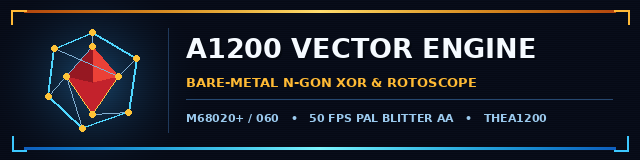

[**Polski**](README.md) | [English](README_EN.md) | [Historia Zmian (PL)](CHANGELOG.md) | [Changelog (EN)](CHANGELOG_EN.md)

# Amiga 1200 / THEA1200 Vector Stream Demo Engine v1.1.2

**Bare-metalowy silnik wektorowy M68020+ / AGA + Blitter AA 320x256 @ 50.00 FPS PAL** (*malek69 & Gemini AI, 2026*)

## Pobieranie i Podgląd (v1.1.2 — 3 Obozy Wydawnicze)

| Median A1200 v1.1.1 | Bad Apple!! A1200 v1.1.0 | Intrinsic Gravity (Still) v1.1.2 |
| :---: | :---: | :---: |
|  |  |  |
| **1. Standard `020` (`320x256` + Blitter AA):** [.LHA](https://github.com/malek69/amiga1200-vector-engine/releases/download/v1.1.2/MedianA1200_AGA_THEA1200.lha) · [.ZIP](https://github.com/malek69/amiga1200-vector-engine/releases/download/v1.1.2/MedianA1200_AGA_THEA1200_FSUAE.zip) **2. THEA1200 (`640x256` AGA Hi-Res):** [.LHA](https://github.com/malek69/amiga1200-vector-engine/releases/download/v1.1.2/MedianA1200_AGA_HiRes640.lha) · [.ZIP](https://github.com/malek69/amiga1200-vector-engine/releases/download/v1.1.2/MedianA1200_AGA_HiRes640_FSUAE.zip) **3. Turbo `MC68060` (`640x512` Interlace):** [.LHA](https://github.com/malek69/amiga1200-vector-engine/releases/download/v1.1.2/MedianA1200_AGA_060_HiRes512.lha) · [.ZIP](https://github.com/malek69/amiga1200-vector-engine/releases/download/v1.1.2/MedianA1200_AGA_060_HiRes512_FSUAE.zip) | **1. Standard `020` (`320x256` + Blitter AA):** [.LHA](https://github.com/malek69/amiga1200-vector-engine/releases/download/v1.1.2/BadappleA1200_AGA_THEA1200.lha) · [.ZIP](https://github.com/malek69/amiga1200-vector-engine/releases/download/v1.1.2/BadappleA1200_AGA_THEA1200_FSUAE.zip) **2. THEA1200 (`640x256` AGA Hi-Res):** [.LHA](https://github.com/malek69/amiga1200-vector-engine/releases/download/v1.1.2/BadappleA1200_AGA_HiRes640.lha) · [.ZIP](https://github.com/malek69/amiga1200-vector-engine/releases/download/v1.1.2/BadappleA1200_AGA_HiRes640_FSUAE.zip) **3. Turbo `MC68060` (`640x512` Interlace):** [.LHA](https://github.com/malek69/amiga1200-vector-engine/releases/download/v1.1.2/BadappleA1200_AGA_060_HiRes512.lha) · [.ZIP](https://github.com/malek69/amiga1200-vector-engine/releases/download/v1.1.2/BadappleA1200_AGA_060_HiRes512_FSUAE.zip) | **3. Intrinsic Gravity (Still — `pixtur` & `Hoffman`)**: • **020 + Blitter AA (`320×256`)**: [.LHA](releases/v1.1.0/Intrinsicgravity_THEA1200.lha) · [.ZIP](releases/v1.1.0/Intrinsicgravity_THEA1200_FSUAE.zip) • **THEA1200 HiRes (`640×256`)**: [.LHA](releases/v1.1.0/Intrinsicgravity_HiRes640.lha) · [.ZIP](releases/v1.1.0/Intrinsicgravity_HiRes640_FSUAE.zip) • **060 Interlace (`640×512`)**: [.LHA](releases/v1.1.0/Intrinsicgravity_060_HiRes512.lha) · [.ZIP](releases/v1.1.0/Intrinsicgravity_060_HiRes512_FSUAE.zip) |

## Trzy Obozy Wydawnicze (3 Target Profiles)
| Profil (`--profile`) | Platforma docelowa | Rozdzielczosc i potok | Audio i detale |
| :--- | :--- | :--- | :--- |
| **`standard`** | Bazowa **Amiga 1200 (`68020`)**, **RetroArch (Android)** | `320x256` AGA + 8-odcieniowy **Blitter AA** @ `50 FPS` | `8–16.5 kHz` PCM, do `550` wierzcholkow |
| **`thea1200`** | Konsola **THEA1200**, **Amiberry (PC)**, **FS-UAE** | Natywne **`640x256` AGA Hi-Res** + Fast-RAM `movem.l` @ `50 FPS` | `12.1–16.5 kHz` PCM, do `650` wierzcholkow |
| **`060`** | Karty turbo **`MC68060` (50+ MHz, Z3 Fast RAM)** | **`640x512` AGA Hi-Res Interlace** (`1:1`, 0 schodkow) | `16.5 kHz` PCM, do `1200` wierzcholkow |

## Warianty Paczek i Kompatybilność (v1.1.2)
- **`.lha` (`*_AGA_THEA1200.lha` — RetroArch PUAE / THEA1200 / Real A1200):** spakowane z naglowkami Amiga LHA Level 1 oraz 78-bajtowymi ikonami WHDLoad `WBPROJECT`. Przetestowane przez **Load Content** w **RetroArch (`PUAE`)** oraz **THEA1200 (`Amiberry`)**.
- **`.zip` (`*_AGA_THEA1200_FSUAE.zip` — FS-UAE Launcher / WinUAE):** archiwum WHDLoad ZIP obslugiwane natywnie bez zewnetrznych wtyczek `python-lhafile`. Auto-boot jednym kliknieciem przez `S/startup-sequence` — zamontuj `.zip` jako dysk twardy (`DH0`) na profilu A1200 (8 MB Fast RAM) i kliknij **Start**.

---

## Wymagania i Sterowanie
- **Sprzęt:** Amiga 1200 (68EC020+ 14 MHz, AGA, **2 MB Chip RAM + 8 MB Fast RAM**), **THEA1200**, FS-UAE lub WinUAE (WHDLoad Slave v17 bez Kickstart ROM).
- **Wyjście:** `LMB`, **Fire (Joystick Port 2 / THEA1200)** lub `ESC`.

## Możliwości silnika
- **Rasteryzator N-gon XOR LUT:** szybkie wypelnianie wielokatow i wycinanie otworow (cutouts) w oparciu o 512 KB tablice prefiksow w Fast RAM.
- **Potok M68020+ / AGA & Paula 4CH DMA:** podwojne buforowanie VBL `50.00 FPS PAL`, 4-kanalowe audio PCM (filtr LED wyl.) oraz konwertery wideo `tools/`.

- **Wielotonowy odtwarzacz scen rotoskopowych *Eon* (TBL) (`src/eon_poly_player.i`):** bezkonturowy rasteryzer wielokątów N-gon w 256 kolorach AGA przeniesiony z gry *Aether Falcon: Vanguard* oraz natywna obsługa **MC68060 (`CACR = $A0808000`, 7.5 MB Fast RAM)**.

## Co nowego w v1.1.2
- **AGA + Blitter AA `320x256` (`BPLCON0 = $A200`, `DDFSTRT = $0028, DDFSTOP = $00B8`, `FMODE = $0003`):** 2x wyzsza ostrosc pozioma wektorow z 64-bitowym DMA bez dlawienia CPU.
- **Fast-RAM Backbuffer + `movem.l` Burst & THEA1200:** rysowanie w Fast RAM, transfer blokowy `48 B/iter` do Chip RAM oraz wyjscie padem THEA1200.

## Architektura i Moduly Silnika (`src/`)

| Modul | Rola w silniku | Mechanizmy sprzetowe i algorytmy |
| :--- | :--- | :--- |
| **`main.s`** | Glowna petla 50 Hz PAL | Synchronizacja VBL (`50.00 FPS`), czyszczenie Fast RAM oraz rozwiniety transfer `movem.l` (`48 B/iter`) `Fast -> Chip` |
| **`gfx_engine.i`** | Inicjalizacja AGA i Coppera | Przejecie sprzetu (`sys_takeover`), tryb **AGA + Blitter AA `320x256`** (`BPLCON0 = $A200`, `DDFSTRT = $0028, DDFSTOP = $00B8`), 64-bitowe bitplany (`FMODE = $0003`), podwojne buforowanie VBL |
| **`vec3d_engine.i`** | Rasteryzator wielokatow N-gon | Skanowanie krawedzi 16-bitowych (`0..639 x 0..255`) do `edge_buf` i wypelnianie z wycinaniem otworow (cutouts) przez 512 KB tablice prefiksow `fill_lut` w Fast RAM |
| **`scene_player.i`** | Dekoder strumienia klatek | Odczyt tablicy klatek `vec_frame_table` i dyspozycja wielokatow na aktywne bitplany AGA |
| **`audio_player.i`** | Odtwarzacz Paula 4CH DMA | Strumieniowe audio PCM z Fast RAM przez podwojne bufory `2048 B` w Chip RAM (IRQ Level 4) z wylaczonym filtrem LED |
| **`eon_poly_player.i`** | Sceny rotoskopowe *Eon* (TBL) | Wielotonowy odtwarzacz bezkonturowych wielokątów N-gon w 256 kolorach AGA (`af_play_eon_scene`) |
| **`whdload_slave.s`** | Loader bez Kickstart ROM | Autorski WHDLoad Slave v17 (`ws_KickSize=0`) alokujacy Chip/Fast RAM i uruchamiajacy demo bez plikow Kickstart |

---

## Narzędzia Deweloperskie (`tools/`)

- **`tools/build_median.py`** — dedykowany potok przetwarzajacy material *Median* (`624x496` -> `320x256` AGA + Blitter AA @ `50 FPS`, separacja warstw czerni i czerwieni, upraszczanie wielokatow i budowa paczek `.lha` + `*_FSUAE.zip`).
- **`tools/build_demo.py`** — uniwersalny konwerter wideo na strumien wektorowy `320x256` AGA + Blitter AA AGA (`--video`, `--fps`, `--threshold`, `--crop-43`, `--thin-lines`) automatycznie kompilujacy binarke `vasmm68k_mot`, WHDLoad Slave oraz archiwa `.lha` i `*_FSUAE.zip`.

---
