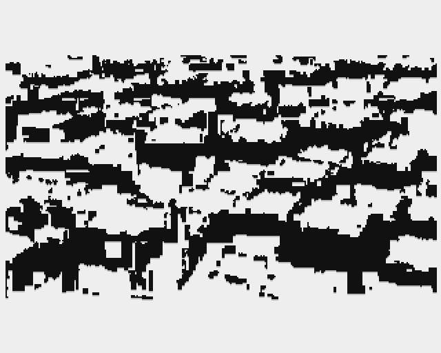

[English Version](README.md)
# Amiga 1200 / THEA1200 Vector Stream Demo Engine v1.0
| Median A1200 v1.0 | Bad Apple!! A1200 v1.0 |
| :---: | :---: |
|  |  |
## Wymagania sprzętowe
- **Komputer / Emulator:** Commodore Amiga 1200 (68EC020+ 14 MHz, AGA), **THEA1200**, FS-UAE lub WinUAE.
- **Pamięć:** **2 MB Chip RAM + 8 MB Fast RAM** (tablica LUT 512 KB + bufor Fast-RAM + strumień A/V).
- **Uruchamianie:** Autorski WHDLoad Slave v17 (`ws_KickSize=0`) — działa bez plików Kickstart ROM. Wyjście: LPM lub `ESC`.
## Wydania (v1.0)
### 1. Median A1200 [Retail v1.0]
- **Opis:** Port dema *Median* (Umlaut Design, 2016) w **50.00 FPS PAL**, 3 kolorach AGA (`#EEE`, `#111`, `#E11`) z wygładzaniem Blittera (`NoMMU`).
- **Wywołania w ramce:** `wait_vbl` -> `blit_clear_full` (`BPL2`) -> `play_vector_frame` -> `draw_polygon_mode` -> `fast_bpl1` -> `apply_blitter_aa` + `aud0_irq_handler`.
### 2. Bad Apple!! A1200 [50FPS + Blitter AA v1.0]
- **Opis:** Pełne 3:39 *Bad Apple!!* (ZUN / Anira) w **50.00 FPS PAL** (1 klatka na VBL) z wycinaniem otworów i antyaliasingiem Blittera.
- **Wywołania w ramce:** `init_fill_lut` (512 KB LUT) -> `draw_polygon_mode` (`inv_tab`) -> transfer `Fast->Chip` -> `apply_blitter_aa` + 4CH DMA Paula.
## Moduły silnika (`src/`)
- `main.s` (pętla 50Hz VBL i transfer Fast->Chip) | `gfx_engine.i` (AGA, Copper, Blitter AA) | `vec3d_engine.i` (rasteryzator wielokątów LUT)
- `scene_player.i` (dekoder klatek) | `audio_player.i` (4CH Paula DMA, filtr LED wył.) | `whdload_slave.s` (loader bez Kickstart ROM)
