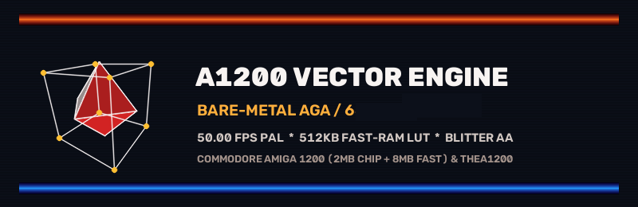
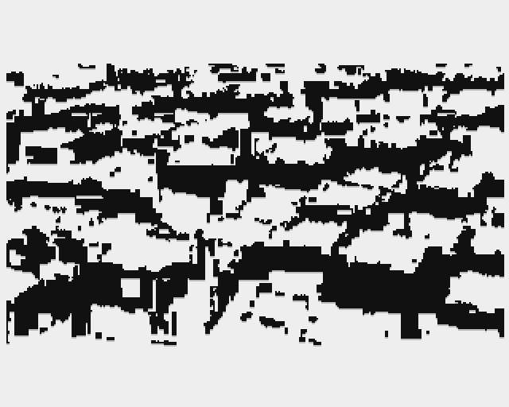
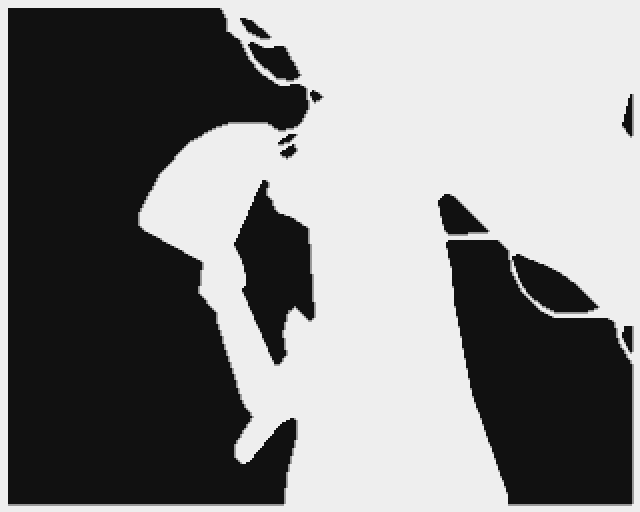
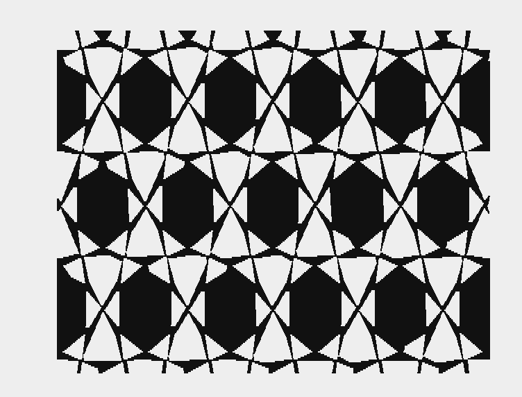

[Polski](README.md) | [**English**](README_EN.md) | [Historia Zmian (PL)](CHANGELOG.md) | [Changelog (EN)](CHANGELOG_EN.md)

# Amiga 1200 / THEA1200 Vector Stream Demo Engine v1.1.2

**Bare-metal M68020+ / AGA + Blitter AA 320x256 @ 50.00 FPS PAL Vector Demo Engine** (*malek69 & Gemini AI, 2026*)

## Downloads & Preview (v1.1.2 — 3 Target Profiles)

| Median A1200 v1.1.1 | Bad Apple!! A1200 v1.1.0 | Intrinsic Gravity (Still) v1.1.2 |
| :---: | :---: | :---: |
|  |  |  |
| **1. Standard `020` (`320x256` + Blitter AA):** [.LHA](https://github.com/malek69/amiga1200-vector-engine/releases/download/v1.1.2/MedianA1200_AGA_THEA1200.lha) · [.ZIP](https://github.com/malek69/amiga1200-vector-engine/releases/download/v1.1.2/MedianA1200_AGA_THEA1200_FSUAE.zip) **2. THEA1200 (`640x256` AGA Hi-Res):** [.LHA](https://github.com/malek69/amiga1200-vector-engine/releases/download/v1.1.2/MedianA1200_AGA_HiRes640.lha) · [.ZIP](https://github.com/malek69/amiga1200-vector-engine/releases/download/v1.1.2/MedianA1200_AGA_HiRes640_FSUAE.zip) **3. Turbo `MC68060` (`640x512` Interlace):** [.LHA](https://github.com/malek69/amiga1200-vector-engine/releases/download/v1.1.2/MedianA1200_AGA_060_HiRes512.lha) · [.ZIP](https://github.com/malek69/amiga1200-vector-engine/releases/download/v1.1.2/MedianA1200_AGA_060_HiRes512_FSUAE.zip) | **1. Standard `020` (`320x256` + Blitter AA):** [.LHA](https://github.com/malek69/amiga1200-vector-engine/releases/download/v1.1.2/BadappleA1200_AGA_THEA1200.lha) · [.ZIP](https://github.com/malek69/amiga1200-vector-engine/releases/download/v1.1.2/BadappleA1200_AGA_THEA1200_FSUAE.zip) **2. THEA1200 (`640x256` AGA Hi-Res):** [.LHA](https://github.com/malek69/amiga1200-vector-engine/releases/download/v1.1.2/BadappleA1200_AGA_HiRes640.lha) · [.ZIP](https://github.com/malek69/amiga1200-vector-engine/releases/download/v1.1.2/BadappleA1200_AGA_HiRes640_FSUAE.zip) **3. Turbo `MC68060` (`640x512` Interlace):** [.LHA](https://github.com/malek69/amiga1200-vector-engine/releases/download/v1.1.2/BadappleA1200_AGA_060_HiRes512.lha) · [.ZIP](https://github.com/malek69/amiga1200-vector-engine/releases/download/v1.1.2/BadappleA1200_AGA_060_HiRes512_FSUAE.zip) | **3. Intrinsic Gravity (Still — `pixtur` & `Hoffman`)**: • **020 + Blitter AA (`320×256`)**: [.LHA](releases/v1.1.0/Intrinsicgravity_THEA1200.lha) · [.ZIP](releases/v1.1.0/Intrinsicgravity_THEA1200_FSUAE.zip) • **THEA1200 HiRes (`640×256`)**: [.LHA](releases/v1.1.0/Intrinsicgravity_HiRes640.lha) · [.ZIP](releases/v1.1.0/Intrinsicgravity_HiRes640_FSUAE.zip) • **060 Interlace (`640×512`)**: [.LHA](releases/v1.1.0/Intrinsicgravity_060_HiRes512.lha) · [.ZIP](releases/v1.1.0/Intrinsicgravity_060_HiRes512_FSUAE.zip) |

## Three Target Profiles (`--profile`)
| Profile (`--profile`) | Target Hardware | Resolution & Pipeline | Audio & Detail Budget |
| :--- | :--- | :--- | :--- |
| **`standard`** | Stock **Amiga 1200 (`68020`)**, **RetroArch (Android)** | `320x256` AGA + 8-shade **Blitter AA** @ `50 FPS` | `8-16.5 kHz` PCM, up to `550` vertices |
| **`thea1200`** | **THEA1200**, **Amiberry (PC)**, **FS-UAE** | Native **`640x256` AGA Hi-Res** + Fast-RAM `movem.l` @ `50 FPS` | `12.1-16.5 kHz` PCM, up to `650` vertices |
| **`060`** | Turbo **`MC68060` (50+ MHz, Z3 Fast RAM)** | **`640x512` AGA Hi-Res Interlace** (`1:1`, 0 stair-stepping) | `16.5 kHz` PCM, up to `1200` vertices |

## Package Variants & Verified Compatibility (v1.1.2)
- **`.lha` (`*_AGA_THEA1200.lha` — RetroArch PUAE / THEA1200 / Real A1200):** packed with Amiga LHA Level 1 headers and 78-byte `WBPROJECT` WHDLoad icons. Tested and verified out-of-the-box via **Load Content** in **RetroArch (`PUAE` core)** and **THEA1200 (`Amiberry`)**.
- **`.zip` (`*_AGA_THEA1200_FSUAE.zip` — FS-UAE Launcher / WinUAE):** standard WHDLoad ZIP archive supported natively without external `python-lhafile` plugins. 1-click auto-boot via `S/startup-sequence` — simply mount the `.zip` as Hard Drive (`DH0`) on an A1200 (8 MB Fast RAM) profile and click **Start**.

---

## Requirements & Controls
- **Hardware:** Amiga 1200 (68EC020+ 14 MHz, AGA, **2 MB Chip RAM + 8 MB Fast RAM**), **THEA1200**, FS-UAE, or WinUAE (Kickstart-free WHDLoad Slave v17).
- **Exit:** `LMB`, **Fire (Joystick Port 2 / THEA1200)**, or `ESC`.

## Engine Capabilities
- **N-gon XOR LUT Rasterizer:** fast arbitrary-vertex polygon filling and hole cutouts via a 512 KB prefix table in Fast RAM.
- **M68020+ / AGA & 4CH Paula DMA:** VBL-locked `50.00 FPS PAL` double-buffering, 4CH PCM audio (LED filter off), and Python video converters (`tools/`).

## What is New in v1.1.2
- **AGA + Blitter AA `320x256` (`BPLCON0 = $A200`, `DDFSTRT = $0028, DDFSTOP = $00B8`, `FMODE = $0003`):** 2x horizontal sharpness with 64-bit DMA and zero CPU contention.
- **Fast-RAM Backbuffer + `movem.l` Burst & THEA1200:** Fast-RAM rasterization, `48 B/iter` Chip-RAM copy, and THEA1200 gamepad exit.

## Engine Architecture &amp; Modules (`src/`)

| Module | Role | Hardware &amp; Algorithms |
| :--- | :--- | :--- |
| **`main.s`** | Main 50 Hz PAL Loop | VBL frame lock (`50.00 FPS`), Fast-RAM buffer clear, and unrolled `movem.l` (`48 B/iter`) `Fast -> Chip` burst transfer |
| **`gfx_engine.i`** | AGA &amp; Copper Setup | Hardware takeover (`sys_takeover`), native **AGA + Blitter AA `320x256`** (`BPLCON0 = $A200`, `DDFSTRT = $0028, DDFSTOP = $00B8`), 64-bit bitplanes (`FMODE = $0003`), VBL double-buffering |
| **`vec3d_engine.i`** | N-gon Polygon Rasterizer | 16-bit edge stepping (`0..639 x 0..255`) into `edge_buf` and XOR span filling with hole cutouts via 512 KB `fill_lut` in Fast RAM |
| **`scene_player.i`** | Frame Stream Decoder | Reads `vec_frame_table` stream and dispatches polygons to target AGA bitplanes |
| **`audio_player.i`** | 4CH Paula DMA Audio | Streams PCM audio from Fast RAM via dual `2048 B` Chip-RAM buffers (Level 4 IRQ) with hardware LED filter disabled |
| **`eon_poly_player.i`** | *Eon* (TBL) Rotoscoped Scenes | Multi-tone borderless 256-color AGA N-gon polygon cutscene player (`af_play_eon_scene`) |
| **`whdload_slave.s`** | Kickstart-Free Loader | Custom WHDLoad Slave v17 (`ws_KickSize=0`) allocating Chip/Fast RAM and booting without external Kickstart ROMs |

---

## Developer Toolchain (`tools/`)

- **`tools/build_median.py`** — dedicated pipeline converting *Median* (`624x496` -> `320x256` AGA + Blitter AA @ `50 FPS`, dual black/red layer extraction, polygon simplification, and packaging into `.lha` + `*_FSUAE.zip`).
- **`tools/build_demo.py`** — universal video-to-vector `320x256` AGA + Blitter AA AGA converter (`--video`, `--fps`, `--threshold`, `--crop-43`, `--thin-lines`) compiling the M68020 executable (`vasmm68k_mot`), WHDLoad Slave, `.lha`, and `*_FSUAE.zip` archives.

---
